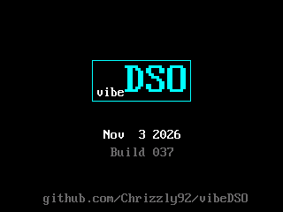
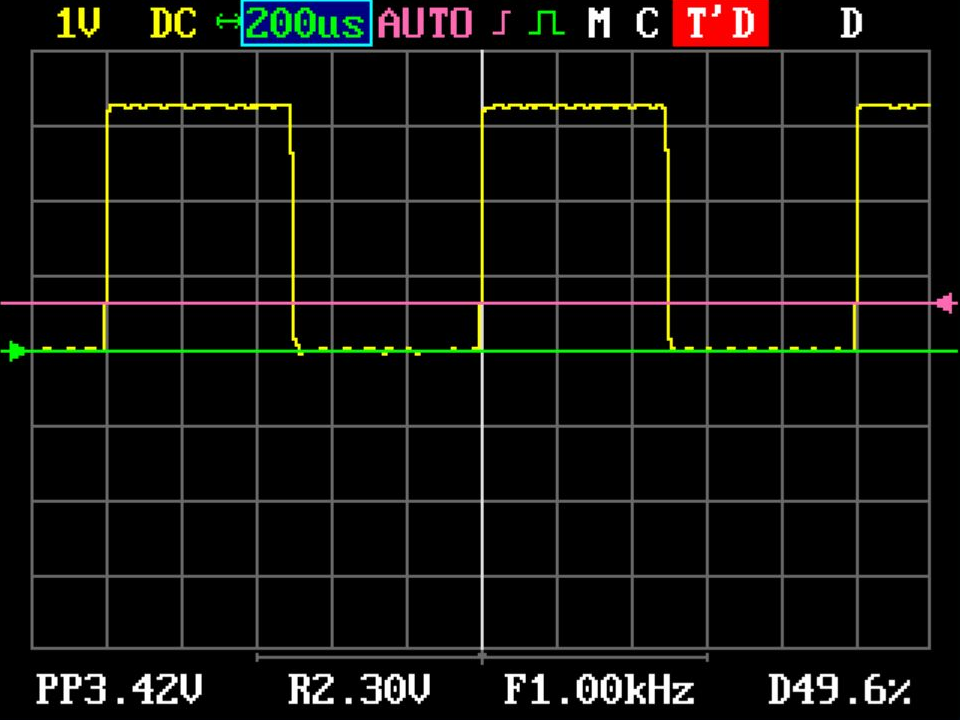
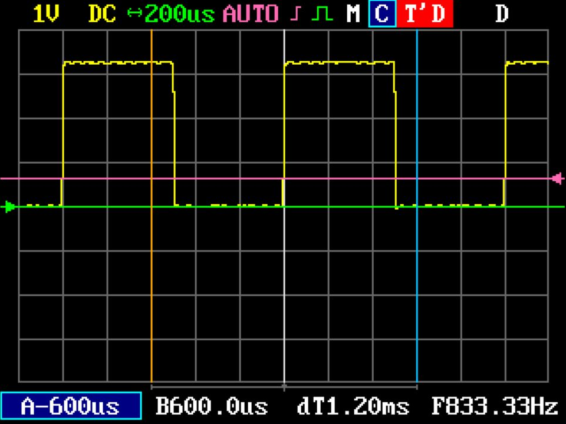
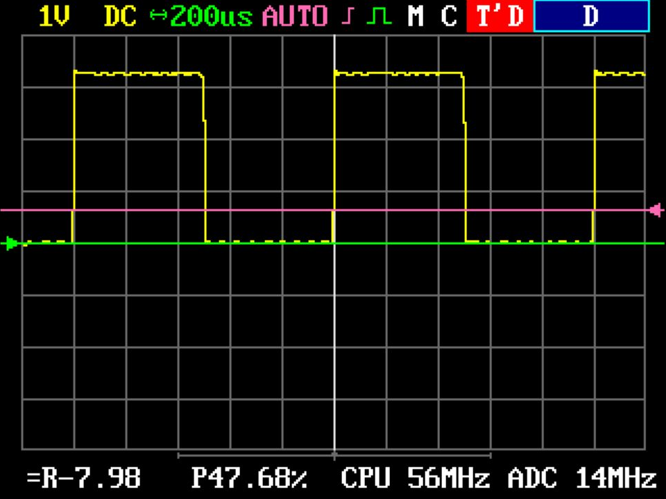
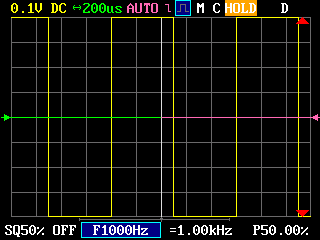
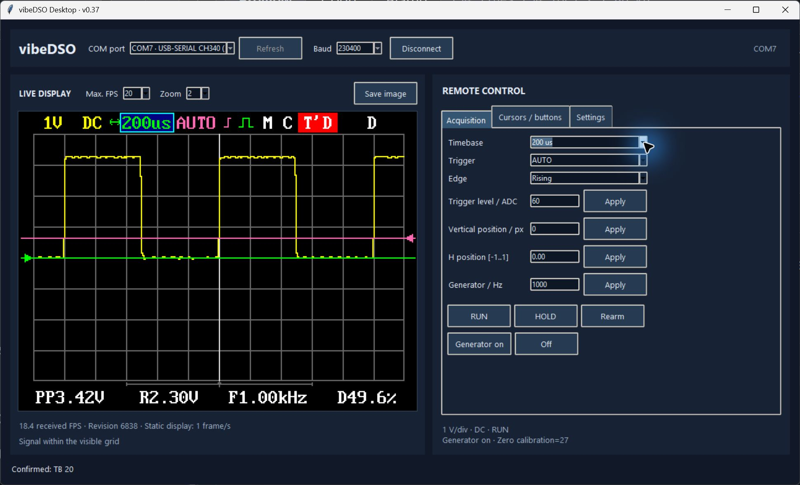

# vibeDSO

vibeDSO is a fully vibe-coded, custom C++ firmware and a standalone Windows desktop application for the DSO138 oscilloscope (STM32F103C8 / ILI9341).

## Downloads

**[Download vibeDSO v0.37](https://github.com/Chrizzly92/vibeDSO/releases/tag/v0.37)** — initial public pre-release.

| Package | Contents |
| --- | --- |
| [Firmware](https://github.com/Chrizzly92/vibeDSO/releases/download/v0.37/vibeDSO-v0.37-firmware.zip) | Flashable HEX for the STM32F103C8 / ILI9341 DSO138, with license notices |
| [Windows application](https://github.com/Chrizzly92/vibeDSO/releases/download/v0.37/vibeDSO-v0.37-Windows.zip) | Standalone EXE; no Python installation required |
| [Source code](https://github.com/Chrizzly92/vibeDSO/releases/download/v0.37/vibeDSO-v0.37-source.zip) | Firmware and desktop sources, build tools, documentation and licenses |

See the [release notes](docs/releases/v0.37.md) for setup and validation limits, or browse [all releases](https://github.com/Chrizzly92/vibeDSO/releases).

The project uses the published JYE source package for board support; source for OEM firmware 113-13801-061 was not available. I used AI to develop a replacement tailored to my hardware modifications and the features I needed.

It is **not** a bit-identical reconstruction of OEM Firmware 113-13801-061.



*Startup screen rendered by the firmware LCD model.*

## Features

### Common features

The goal is to retain the main oscilloscope functions while adding useful features. The shared functions are listed below; known omissions appear in the differences table.

| Feature | OEM DSO138 | vibeDSO |
| --- | --- | --- |
| Input channels | 1 | 1 |
| ADC resolution | 12 bit | 12 bit |
| Vertical sensitivity | 10 mV/div–5 V/div | 10 mV/div–5 V/div |
| Input coupling | DC / AC / GND | DC / AC / GND |
| Maximum sample rate | 1 MS/s | 1 MS/s |
| Maximum record length | 1,024 samples | 1,024 samples |
| Timebase | 10 µs/div–500 s/div | 10 µs/div–500 s/div |
| Trigger modes | AUTO / NORMAL / SINGLE | AUTO / NORMAL / SINGLE |
| Trigger edges | Rising / falling | Rising / falling |
| Waveform HOLD | Yes | Yes |
| Vertical/horizontal position | Adjustable | Adjustable |
| Trigger/horizontal centering | Yes | Yes |
| Automatic measurements | Yes | Yes |
| Factory settings reset | Yes | Yes |

Both provide **Vmax, Vmin, average voltage, Vpp, RMS, frequency, period, pulse width and duty cycle** readouts. Voltage range and coupling are selected using the same physical switches.

### Device views

These are **real hardware captures** from a DSO138 connected to its internal 1 kHz generator, received over UART. They are crops of the desktop mirror, not photographs of the LCD.

| Waveform and automatic measurements | Time cursors |
| --- | --- |
|  |  |

The cursor footer shows the selected separation and **1/Δt**; it is separate from the automatic signal-frequency measurement.

### Differences

This firmware mainly adds quality-of-life features. One is active PWM feedback for the **raw negative supply before U4**, targeting approximately **−8 V**. U4 then regulates this to **−5 V**. The firmware does not measure or directly regulate the −5 V output itself.

Development used a USB-powered board retaining U4. Full operation on an unmodified stock board has not been validated. The author's USB modification connects VBUS to the +5 V rail and bypasses U5's **input and output nets** after removing the regulator. Physical pin positions depend on the board/regulator variant. This is a board-specific modification, not a universal two-step recipe: the original higher-voltage input path must not be able to feed the USB/+5 V rail. See [USB power modification notes](docs/USB_POWER.md) before reproducing it.

Also, vibeDSO adds highlighted menu fields, zero/trigger arrows and reference lines, normalized H position, accelerated button repeat, clipping indicators and peak-preserving roll rendering.

For easier updates, hold **+ and − during power-on/reset** to enter the STM32 ROM UART bootloader.
See [firmware updates](docs/BOOTLOADER.md) for the bootloader shortcut.

The desktop app mirrors and controls the DSO and exports display images as PNG. Separate UART tools can export recorded samples. On-device waveform save/recall is intentionally omitted for now; PC image/sample export does not restore a saved waveform on the device. PC communication requires a 3.3 V USB-UART adapter (for example, a suitable CH340-based adapter); native USB data is not implemented.

The main differences at a glance:

| Feature | OEM DSO138 | vibeDSO |
| --- | --- | --- |
| Square-wave test output | Fixed 1 kHz | Adjustable **1 Hz–100 kHz** |
| Time/voltage measurement cursors | Not documented | A/B cursors with delta measurements |
| PC connection | No corresponding feature documented | UART display mirror, record export and remote control |
| PC application | No corresponding application documented | English Windows app with COM selection, zoom, controls and PNG export |
| Power diagnostics/control | Equivalent behavior not established | Raw negative-rail feedback, fault protection and Debug pages |
| Bootloader startup shortcut | No key combination documented | Hold **+ and − during power-on/reset** |
| On-device waveform save/recall | Supported | **Not implemented** |
| LCD controllers | ILI9341 / ILI9325 / ILI9328 | **ILI9341** |
| Enhanced short-circuit self-test | Supported since v050 | Equivalence to the enhanced OEM test not established |

### Features in action

| Power diagnostics — real hardware | ADC clipping — simulation |
| --- | --- |
|  |  |

The Debug capture shows the **raw voltage before U4**, not its regulated −5 V output. The clipping example uses synthetic ADC samples in the firmware LCD model; no hardware overload was induced. [Image provenance](docs/images/README.md).

OEM references: [DSO138 specifications](https://jyetech.com/dso-138-oscilloscope-diy-kit/) and [firmware revision history through v061](https://jyetech.com/firmware-dso-138/). "Not documented" refers to these sources and does not prove that a feature is absent from every OEM implementation.

The shared sample-rate figure is nominal; it does not establish identical accuracy or timing. See [Validation](#validation) for the current limits.

## TODO
Software is good enough as-is for my use cases, but if anyone wan't to contribute using their brain (or AI credits), feel free to do so! The following things are planned though:

-add support for other display versions;

-gather more calibration data, especially for the 10mV range;

-improving ADC-behaviour and signal noise


## Build the firmware

Install Python 3.9+ and GNU Arm Embedded GCC (`arm-none-eabi-g++`, `objcopy`, `objdump`, `nm`, `size`). No Python packages are needed for the firmware build itself.

```powershell
python tools/build.py --toolchain C:/path/to/arm-toolchain/bin
```

Outputs: `build/source/dso138.hex`, `.elf`, `.bin`, `.map` and disassembly. Flash the HEX using your existing STM32 programming method. Do not mass-erase saved calibration if you want to preserve it.

Alternatively, use CMake 3.21+ and Ninja:

```powershell
$env:ARM_GCC_BIN = 'C:/path/to/arm-toolchain/bin'
cmake -S . -B build/cmake-source -G Ninja -DCMAKE_TOOLCHAIN_FILE=cmake/arm-gcc.cmake -DDSO_ENGINE=source
cmake --build build/cmake-source
```

This repository builds the source engine by default. The optional reference profile requires a separately supplied OEM capture library; it is not needed for the standard build.

## Run or build the desktop app



*Actual Windows desktop application connected to the device over UART; the internal generator is set to 1 kHz. Displayed readings are examples, not independent calibration references.*

Python 3.12 with Tk was used for validation. On some Linux distributions, Tk must be installed separately. The frozen Windows EXE bundles Python and Tk.

```powershell
python -m venv .venv
.venv/Scripts/python -m pip install -r requirements-desktop.txt
.venv/Scripts/python tools/dso138_app.py
```

Select the adapter's COM port, leave 230400 baud, then **Connect**. Close other serial viewers first. Controls become available after the firmware confirms its state. Range and coupling remain physical switches on the device. The baud selector does not reconfigure the firmware.

```powershell
.venv/Scripts/python tools/dso138_app.py --demo
.venv/Scripts/python -m pip install -r requirements-build-desktop.txt
.venv/Scripts/python tools/build_app.py --output dist
```

The Windows build produces `dist/vibeDSO-Desktop-v0.37.exe`. The demo fixture and original LCD font are included in the source tree; no generated analysis folder is required to build or run the app. See [desktop operation](docs/PC_APP.md).

## Validation

Host checks use GCC/Clang or MSVC and register/LCD models; they do not simulate real analog hardware or ADC timing. Run native fixture producers before Python protocol tests:

```powershell
python tools/test_host.py
python tools/test_host.py --settings
python tools/test_host.py --commands
python tools/test_host.py --bootloader
python tools/test_host.py --screen
python tools/test_host.py --link
python tools/test_host.py --mirror
python tools/test_host.py --remote
python tests/test_capture.py
python tests/test_mirror.py
python tests/test_control.py
python tests/test_calibrate.py
python tools/dso138_app.py --self-test analysis/app-tests.json
python tests/test_app_popup.py
```

`test_host.py` creates ignored build/analysis directories. Additional flags cover power control, clocks, the generator, stream statistics and measurement calculations. Optional ELF validation uses `pip install -r requirements-validation.txt` then `python tools/verify_build.py`. Check bundled source/license integrity with `python tools/check_licenses.py`. See [validation coverage](docs/VALIDATION.md) for the scope and limits of these checks.

The screenshots above demonstrate live mirroring, remote timebase/focus selection, time cursors and power diagnostics on the connected device. Other validation uses model/build checks; this is not an exhaustive hardware or electrical validation. Calibration values in the source and reference test data are from one device; do not assume they calibrate your own board. Four low-voltage ranges still need reliable references. Captures and UART records have gaps; the mirror is limited to 20 changed scenes/s. No continuous 1 MS/s UART export or IBIS decoder is implemented.

## Repository and licensing

[github.com/Chrizzly92/vibeDSO](https://github.com/Chrizzly92/vibeDSO)

The upload package excludes generated executables, build outputs, OEM binaries and local toolchains. Upload application binaries separately as GitHub Release assets. New vibeDSO work is licensed under **Apache-2.0**, allowing forks, modifications and commercial sale. Redistributors must retain the relevant attribution from [NOTICE](NOTICE), including this GitHub URL, and comply with the [license scope](LICENSE.md) and third-party terms. This does not require an advertising link or unchanged boot screen.

The project includes pinned, officially Apache-licensed ST/Arm components. See [licensing and distribution](docs/LICENSING.md). To produce source and firmware ZIPs with their license notices, run `python tools/package_release.py` after building; add `--desktop dist/vibeDSO-Desktop-v0.37.exe` for the desktop package. These ZIPs are the intended GitHub Release assets.
